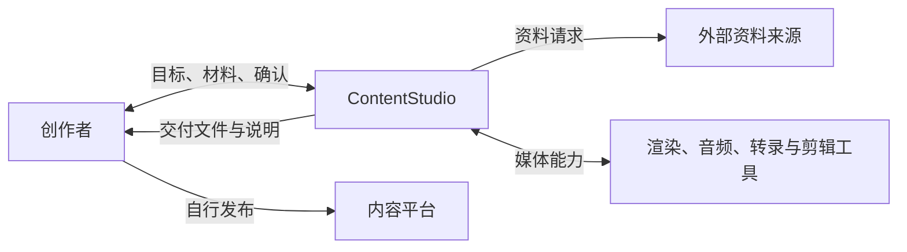
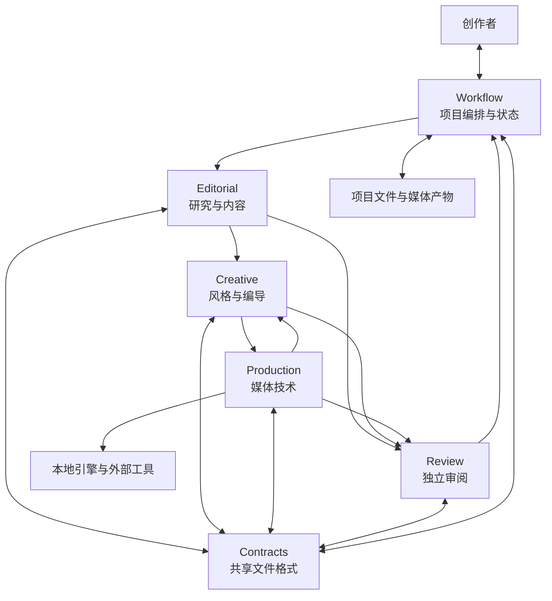

# ContentStudio 总体架构设计

| 项目 | 说明 |
| --- | --- |
| 文档类型 | 系统架构与产品规格 |
| 版本 | 1.0 |
| 状态 | 当前目标架构；实现状态以“当前实现”一节为准 |
| 面向读者 | 创作者、Agent、系统维护者和贡献者 |
| 配套文档 | [模块设计与交接](module-design.md) |

本文同时说明系统要满足什么、系统为什么这样拆、各模块如何协作、仓库如何组织，以及哪些能力已经存在。业务要求采用 spec 的场景、需求和验收结构；技术部分记录架构决策、模块视图、数据边界和演进方式。文中的“必须”是系统要求，“当前”描述代码库现状，“后续”表示尚未承诺的扩展方向。

## 1. 系统目标

ContentStudio 面向创作者和 Agent，管理从选题到作品归档的内容生产过程。它把内容判断、创意表达、媒体制作、审阅和项目进度分开管理，再通过文件和明确的交接记录把它们连起来。

核心原则是：**内容是创作的依据，视觉是内容的表达方式，技术是实现手段，工作流负责记录和推进，审阅负责检查实际作品。**画面再漂亮也不能替代知识可靠性；渲染成功也不等于内容通过。

系统的架构目标：

1. **知识可靠**：正式表达能追溯内容依据、适用条件与不确定性。
2. **创作自主**：Creative 根据任务推荐风格，并保留每种风格自己的表达语法。
3. **媒体可交付**：创作工程能经由制作能力变成真实文件，返回实测属性和失败原因。
4. **项目可恢复**：项目状态、确认、产物和依赖保存在文件中，换 Agent 或新会话仍可继续。
5. **架构够轻**：一个仓库、文件优先、少量稳定合同；没有实际需求时不增加服务、数据库或通用插件平台。

## 2. 用户场景与需求

### 场景 A：从选题完成一件作品（P1）

创作者给出一个问题和受众，Agent 完成研究、表达、制作、审阅并交付。

- **验收**：项目有唯一 ID、状态快照和 brief；各阶段产物能通过引用追溯；交付指向实际通过审阅且由创作者确认的版本。
- **独立价值**：即使只接入一种视频风格，也能完整管理一个作品项目。

### 场景 B：内容不变，按任务选择不同表达（P1）

Creative 接收同一份内容依据，可根据理解目标提出档案拼贴、白板推导、数据图表或其他适合的表达。

- **验收**：方案说明风格与理解目标的关系；风格特有字段和组件留在 Creative 内部；缺少真实材料时不伪造素材。
- **独立价值**：可以新增一种风格，而无需把其视觉规则写进 Editorial 或 Workflow。

### 场景 C：中断后恢复、修改后重新审阅（P1）

项目停在任一阶段后，Agent 根据当前快照继续；输入文件变化时识别受影响的下游产物。

- **验收**：快照指出待办、阻塞和确认；确认与 ReviewReport 绑定文件 SHA-256；文件变更不能继承旧版本的确认或审阅结论。
- **独立价值**：项目可由另一个 Agent 恢复，不依赖原会话记忆。

### 边界场景

- 资料不足或互相冲突：标明未解决的问题，不将推测变成事实。
- 没有口播的作品：不创建无意义的音频和口播时间轴要求。
- 请求超出当前制作引擎能力：返回不支持的字段及影响，由 Creative 调整方案。
- 媒体文件生成失败：保留诊断和最后有效产物，不能登记为完成。
- 代码、字体或示例素材许可不同：按各自许可处理，根许可证不能覆盖第三方材料。

## 3. 系统边界与上下文

### 3.1 系统上下文



ContentStudio 管理内容生产与文件交付。信息来源、外部媒体工具、仓库托管和内容平台是边界外的依赖。首期不自动向平台发布，也不假定所有外部服务始终可用。

### 3.2 责任边界

| 责任 | 归属 |
| --- | --- |
| 事实主张、证据与内容范围 | Editorial；关键结论由创作者确认 |
| 风格选择、视觉叙事和镜头组织 | Creative；重要创作方向由创作者确认 |
| 渲染、音频/字幕处理、组装与文件探测 | Production |
| 项目阶段、依赖、用户确认和归档 | Workflow |
| 质量检查与问题归属 | Review |
| 最终发布和公开平台运营 | 创作者或外部平台工具 |

下游可以提出修改请求，但不能静默重写上游拥有的决定。例如，Creative 可以指出制作稿难以表现，并请 Editorial 改稿；不能为迁就镜头自行更改知识结论。

## 4. 架构分解

采用**模块化单体（modular monolith）**：代码部署和仓库统一，逻辑职责清晰。模块不是独立微服务，也不要求一模块一个 Agent。这样既让 Agent 能按责任找到材料，又避免增加服务部署、网络调用和重复状态管理。



图中的箭头是工作交接，不表示必须通过网络 API 调用。当前交接以项目文件、Schema、Skill 指引和本地 CLI 完成。

### 4.1 五个逻辑模块

| 模块 | 聚合在一起的工作 | 主要变化原因 |
| --- | --- | --- |
| Editorial | 知识研究、内容理论、渠道组织、稿件与内容约束 | 研究方法、内容模型、渠道表达变化 |
| Creative | 风格判断、全片编导、风格组件和原生画面工程 | 风格方法、镜头语言和创意组件变化 |
| Production | 媒体资源、运行时、渲染/音频/字幕/组装适配 | 引擎、编解码、外部媒体工具变化 |
| Review | 作品检查、QA 工具、问题报告和复核 | 质量标准和检查手段变化 |
| Workflow | 路由、状态快照、确认、恢复、归档和索引 | 项目生命周期、阶段门禁和存储方式变化 |

模块边界按“由谁维护这类决定”和“什么原因会让它变化”划分，而不是按执行步骤或文件后缀划分。细分组件见[模块设计文档](module-design.md)。

### 4.2 合同与数据平面

系统以文件作为正式工作载体，避免把内容只留在对话或临时进程内存。跨模块记录用共享 Schema 校验，具体模块可以在内部使用自己的结构。

公共记录集中在 `contracts/studio.schema.json`：

- `ProjectSnapshot`：项目当前状态、待办、确认和渠道进展。
- `ProjectBrief`：受众、学习目标、内容引用和交付约束。
- `CreativePlan`：创作方向、视觉单元和相应依据。
- `ProductionRequest`：实际制作需要和期望输出。
- `ArtifactManifest`：实产文件、输入引用、媒体属性与诊断。
- `ReviewReport`：审阅对象、问题和通过/返工结论。
- `AssetManifest`、`Timing`：素材来源/属性以及实际时间关系。

产物引用至少带 `artifact_id`、相对路径和 SHA-256。文件名没有变化不代表内容没有变化。快照只保留当前状态与必要引用；运行日志只用于诊断，不是第二份项目状态。

### 4.3 控制平面与执行记录

Workflow 的 CLI 是 Agent 的控制入口，负责判断“下一步该谁做、前提是否满足、结果如何登记”。模块的长文本、镜头工程和媒体文件属于工作产物；项目快照属于控制记录；`runtime/` 日志属于诊断信息。这三类数据不互相替代。

## 5. 依赖方向与模块规则

依赖规则用来防止模块变成一团互相读写的脚本：

1. `contracts/` 定义跨模块的最小稳定格式，不塞入某一种风格的内部参数。
2. Editorial、Creative、Production 和 Review 通过文件引用与结果交接，不直接修改彼此的正式产物。
3. Workflow 读取各模块结果并独占 `project.yaml` 写入权；索引从项目快照派生，可重建。
4. Production 引擎作为适配器被调用；上层描述“要制作什么”，不直接依赖某引擎的私有调用细节。
5. Creative 的风格组件可以调用共享绘制能力，但风格方法由各自风格包拥有。
6. 创作工程引用仓库能力和项目资产，不把整套上游仓库复制进每个项目。
7. 任何模块都不能绕过用户确认或把失败伪装成完成。

### 5.1 依赖失效和返工传播

每项产物记录输入引用。输入文件指纹变化时，下游结果先标记为需要复核，而不是假设仍有效：改 Core 可能影响制作稿、创作计划、成片与审阅；只改一个镜头可能只影响该镜头及最终成片。Workflow 记录待处理范围并保留最后一个有效版本。系统不承诺自动推导所有语义影响；模块要指出实际依赖。

## 6. 关键架构决策

| 决策 | 采用方式 | 原因与代价 |
| --- | --- | --- |
| 一个仓库还是多个仓库 | 一个 ContentStudio monorepo | 统一版本和许可检查，Agent 易于找上下游；模块不能各自独立发布 |
| 服务还是模块化单体 | 模块化单体、文件优先 | 本地 Agent 工作不需要常驻服务；边界主要靠责任、文件和 Schema，而非进程隔离 |
| 状态存在哪里 | 每项目一个 `project.yaml` | 可读、可恢复、易归档；写入必须集中到 Workflow，防止覆盖 |
| Agent 数量 | 由任务决定的逻辑角色 | 不让五个模块强制产生五个常驻 Agent；独立审阅仍需与制作者分开 |
| 风格如何选择 | Creative 根据内容目标推荐，创作者确认重要方向 | 内容层提出目标，视觉专业判断留给创作层 |
| 引擎如何接入 | Production 提供引擎适配，创作工程保留原生结构 | 可复用 Canvas 能力；不承诺万能场景语言或自动转换 |
| Huashu 如何归属 | 吸收被采用的代码、方法和示例，按来源和许可记录 | 形成 Creative/Production 的本地能力；不让上游仓库成为运行时依赖 |

### 6.1 创作风格与制作技术是两条独立变化轴

风格回答“观众看到什么、怎样理解”；制作技术回答“怎样绘制、怎样运行、怎样输出”。例如 Vox 是一套视觉叙事方法；Canvas 是绘制/运行能力；SVG 是可被不同运行时使用的图形格式；Remotion 是可考虑接入的制作技术，不与 SVG 处在同一分类层级。

因此：

- 新增 Vox 之外的风格，扩展 Creative 的风格注册、方法和专属组件。
- 新增 Canvas 之外的渲染引擎，扩展 Production 的适配和能力声明。
- 只在多个风格确实共用时，才把工具提升为共享能力。
- 新引擎不能要求所有创作工程迁入一个全新的万能描述语言。

## 7. Agent 执行与项目状态

### 7.1 执行模型

系统按“指挥与执行”分工，但这是逻辑分工，不是固定 Agent 产品部署：

- 指挥角色调用 Workflow，读取快照、选路由、等待用户决定、登记模块结果。
- Editorial、Creative、Production 各自处理专业产物。
- Review 对实际产物和必要依据做独立检查。
- 一个 Agent 可顺序承担多个角色；审阅者在需要独立审阅时不能与该作品的制作者是同一执行者。

Agent 重新开始工作时读取项目文件，不靠长对话记忆恢复。一次工作完成后返回实际修改的文件、输入引用、结果和未解决事项。

### 7.2 项目生命周期与状态门禁

```text
idea → content → script → creative → production → review → delivery → archived
```

这表示主要阶段，不意味着所有媒体形式必须执行相同步骤。渠道和媒体形式可以各自有子任务；图文不走音频阶段。某阶段通过的依据是所需产物存在且满足前置条件，不是 Agent 在文本中说“完成”。

必须保留以下门禁：

- 未确认的 Core 不能作为正式内容真源。
- 未确认重要创作方向时，不开始会不可逆或成本较高的大规模制作。
- 最终交付要求 ReviewReport 指向当前文件指纹并通过、无未解决阻断项。
- `delivery` 与 `complete` 绑定同一版成品，且确认来自真实用户行为。
- 文件改动后旧指纹确认不再适用；归档前检查相对路径和产物存在。

## 8. Monorepo 文件组织

```text
ContentStudio/
├── contracts/       跨模块 Schema 与最小例子
├── modules/
│   ├── editorial/   内容理论与编辑能力
│   ├── creative/    风格、创作 Skills、风格组件、示例和参考工程
│   ├── production/  媒体运行时、引擎适配、渲染/音频/组装脚本
│   ├── review/      QA 工具、审阅 Skill 和 ReviewReport 入口
│   └── workflow/    CLI、路由、项目存储、校验与归档
├── projects/        本地项目工作数据；真实项目和 index.yaml 由 Git 忽略，仅保留空白模板
├── runtime/         本地日志与临时运行信息；默认由 Git 忽略
├── third-party/     上游代码范围和来源许可
├── docs/            使用说明与公开架构规格
└── pyproject.toml   Python 环境与工具依赖
```

版本统一在仓库级管理，公共 Schema 由相关模块共同维护。项目文件允许独立归档；可复用的系统代码不塞进 `projects/`。示例、参考工程、正式项目和第三方资产分开存放并标注用途。

仓库中的 `projects/index-temp.yaml` 是不含真实项目数据的起始模板。首次使用时复制为本地 `projects/index.yaml`；Workflow 会在初始化或重建索引时更新本地索引。真实 `index.yaml`、项目目录和项目内容不得随系统仓库公开。

## 9. 信任、版权和分发边界

- ContentStudio 自有软件和软件文档按根目录 MIT 许可；准确范围见 `LICENSE-SCOPE.md`。
- Huashu 代码只在 `third-party/huashu/FILE-SCOPE.csv` 记录的文件范围内沿用上游 MIT。Huashu 的 MIT 不代替 ContentStudio 对自有代码的许可。
- Huashu 作者明确排除的卡通角色图和帧只用于上游 Skill 示范，不随 MIT 授权其他用途；这些文件已从 ContentStudio 产品目录移出，不作为系统依赖或公开产品资产。
- 示例角色、图片、声音、引用项目素材和字体按各自许可管理；公开仓库不等于素材自动开放。
- 不把个人 `projects/` 数据、凭据、环境文件、渲染输出和运行日志默认纳入版本控制。
- 项目文件中的来源、使用范围和必要署名要随作品保存；许可不清的素材不得进入公开发行包。

## 10. 验收标准

1. 一个新的 Agent 能只根据项目快照和 brief 找到下一项工作及所需输入。
2. 所有跨模块交接都能追溯到源文件和版本指纹，状态只有 Workflow 写入。
3. 至少一种视频和一种图文工作可以按适用路径完成；图文没有音频前置条件。
4. Creative 能用不同风格完成不同表达，新增风格不要求修改 Editorial 的内容合同。
5. Production 能说明实际产生了什么、使用了什么输入，以及哪些参数没有达到要求。
6. 内容、媒体和交付检查分工明确；任何一项失败不会被另一项的“通过”掩盖。
7. 项目可以归档并恢复；归档后不依赖 huashu 原始工程目录或个人绝对路径。
8. 仓库不需要常驻服务、第二套状态数据库或重复的镜头状态文件才能完成上述工作。

## 11. 当前实现与后续边界

当前目录已经采用一个根仓库下的五模块布局，公共合同在 `contracts/studio.schema.json`，Agent 工作入口为 `modules/workflow/scripts/studio.py`。Creative 包含风格索引、Skills、示例和参考工程；Production 当前主要采用 Canvas 能力并有媒体准备、组装和探测脚本；Review 有技术 QA 和版本绑定报告入口。

当前系统实际支持的命令、输入格式、媒体参数和门禁，以 README、`docs/usage/`、Schema 和代码为准。Remotion、自动平台发布、常驻多 Agent 调度和所有格式的自动互转均不是当前承诺；未来接入时需要在所属模块新增真实实现和验收，不得只在文档中宣称支持。

后续实现变化时，先更新所属模块和公共合同，再同步本文的当前实现段落。历史迁移记录及旧工程来源留在工作区归档，不作为 ContentStudio 的运行依赖。
