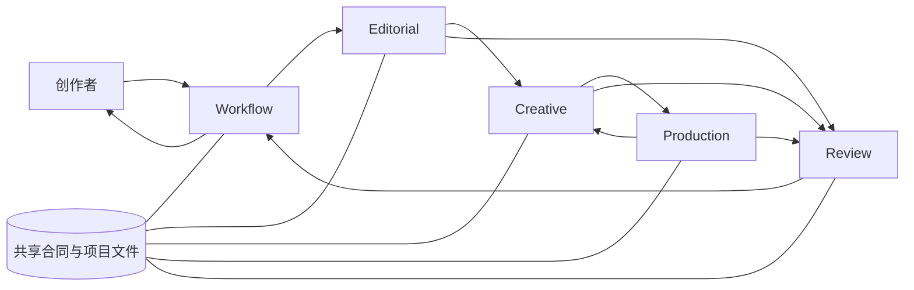

# ContentStudio 模块设计与交接

| 项目 | 说明 |
| --- | --- |
| 文档类型 | 模块架构、内部职责和跨模块合同 |
| 版本 | 1.0 |
| 相关架构 | [ContentStudio 总体架构设计](architecture.md) |
| 目标读者 | 模块 Agent、系统维护者、贡献者 |
| 设计约束 | 内容主导、职责清楚、低耦合、高内聚、文件交接、不过度建设 |

## 1. 设计方法

本文件把系统逐层拆开：

```text
ContentStudio 系统
  ├─ Editorial：内容专业模块
  ├─ Creative：创作专业模块
  ├─ Production：媒体技术模块
  ├─ Review：质量检查模块
  └─ Workflow：项目控制模块
```

模块是有明确决策权的责任边界。模块内部可以继续包含 Skills、风格包、脚本、引擎和检查器，但这些子组件不自动成为新的顶层模块或 Agent。

**高内聚**指经常一起变化、需要一起判断的事情放在一起。例如，Vox 的构图、镜头关系和素材规则放在 Vox 风格能力内。**低耦合**指其他模块通过小而稳定的交接知道需要什么，不需要了解 Vox 内部每一张卡片怎样画。

交接不等于 HTTP API。当前主要通过项目文件、共享 JSON Schema、CLI 返回结果和 Agent Skills 完成。只有确实需要远程服务时，才考虑网络接口。

## 2. 模块交接总览



| 阶段 | 上游提供 | 下游完成 | 下游返回 |
| --- | --- | --- | --- |
| Editorial → Creative | 已确认的内容依据、制作稿、受众、理解目标、限制和素材现状 | 选择表达方式、规划完整叙事和视觉实现 | CreativePlan、素材要求、待澄清问题 |
| Creative → Production | 原生创作工程、制作请求、资源和输出要求 | 按实际能力准备、渲染、合成或导出 | 媒体文件、ArtifactManifest、技术诊断 |
| Production ↔ Creative | 真实能力、媒体属性、时间信息和资源问题 | Creative 调整时序或方案，Production 执行制作 | 修订请求及新版本产物 |
| 各模块 → Review | 该阶段的产物和被引用的依据 | 对内容、表达、技术或交付范围检查 | ReviewReport、问题位置、责任模块 |
| Review → Workflow | 有版本引用的报告和结论 | 更新项目待办、阻塞、确认与阶段 | 新快照和下一项工作 |
| Workflow → 创作者 | 需要决策的方案、内容或候选产物 | 创作者作出真实选择和确认 | 指向确切产物版本的确认记录 |

Workflow 是协调者，不是拥有全部专业工作的“大 Agent”。各模块可以由同一个 Agent 顺序执行，也可以由不同 Agent 或本地脚本执行。

## 3. 跨模块合同与记录

共享格式集中在 `contracts/studio.schema.json`。它约束交接双方必须理解的部分，不定义风格组件或渲染器内部参数。

| 合同 | 典型位置 | 写入责任 | 核心字段/作用 |
| --- | --- | --- | --- |
| ProjectSnapshot | `projects/<id>/project.yaml` | Workflow 独占写入 | 项目身份、阶段、渠道、待办、阻塞、确认和产物引用 |
| ProjectBrief | `projects/<id>/brief.yaml` | Editorial 整理；包含用户要求 | 受众、理解目标、内容依据、目标渠道和交付条件 |
| CreativePlan | `channels/<target>/creative/plan.yaml` | Creative | 风格理由、叙事/镜头单元、依据、素材要求与待确认方向 |
| ProductionRequest | `channels/<target>/production/request.yaml` | Creative 提出；Production 检查可执行性 | 工程入口、输入资源、动作/时间信息和输出要求 |
| ArtifactManifest | `channels/<target>/production/artifacts.yaml` | Production | 实际文件、输入指纹、分辨率、时长、帧率、音轨等实测信息 |
| ReviewReport | `channels/<target>/review/<id>.yaml` | Review | 审阅范围和指纹、问题位置、严重性、责任模块及结论 |
| AssetManifest | 项目内资产清单 | Production 整理；Creative 可提出需求 | 来源、指纹、许可/用途、媒体属性和项目相对路径 |
| Timing | 项目内时间记录 | Production 生成或核对 | 时间轴对应的稿件/音频版本、时间单位和同步精度 |

具体相对路径由 Workflow 创建的项目布局和相应 Skill 约定；上表的路径表示公共布局，不允许 Agent 把绝对机器路径当作正式接口。

### 3.1 版本、确认和状态

- 产物引用用 `artifact_id`、相对 `path`、`sha256` 标识文件和版本。
- CreativePlan 重要方向的确认、稿件确认、交付确认分别指向实际版本；不以文件名或聊天摘要代替指纹。
- 模块只写自己的产物。只有 Workflow 更新项目快照和派生索引。
- `runtime/runs.jsonl` 记录执行诊断，不得用它恢复或覆盖当前项目状态。
- 一个文件改变后，Workflow/Review 标明受影响的下游工作；未受影响的工作可保留，但要有依据说明。

## 4. 决策所有权

| 决定 | 主责模块 | 可以提出建议的模块 | 谁确认 |
| --- | --- | --- | --- |
| 事实主张、证据强度、内容边界 | Editorial | Review、Creative | 创作者确认关键内容 |
| 受众、理解目标和渠道表达 | Editorial | Workflow、Creative | 创作者确定项目目标/入口 |
| 视觉风格、镜头关系、页面构成 | Creative | Editorial、Review、Production | 创作者确认重要方向 |
| 引擎能力、媒体属性、编码与组装 | Production | Creative、Review | 由交付要求和审阅决定是否达标 |
| 问题严重性、审阅结论 | Review | 各专业模块可提供依据 | 独立审阅者签出实际意见 |
| 当前阶段、任务、阻塞和归档 | Workflow | 所有模块提交结果 | 创作者确认关键节点和最终完成 |

模块之间可以协商，但所有权不模糊：下游可提出更改请求；改变上游拥有的内容或决策时，回到该模块改正式文件并重新确认。

## 5. Editorial：内容研究与编辑

### 5.1 对外职责

把创作者的选题变成有依据、有边界、适合指定渠道表达的内容材料，供 Creative 编导、Review 核对。

### 5.2 内部能力分解

| 子能力 | 主要工作 | 现有能力归属 |
| --- | --- | --- |
| Idea → Core | 从问题和材料形成可核查的核心解释；记录证据与不确定性 | `idea-to-core` 及相应研究 Skill |
| Core → Base | 把知识拆成主张、论据、例子和依赖 | `core-to-base-content` |
| Core → Shell | 找到观众熟悉的问题、场景或冲突作为表达入口 | `core-to-shell` |
| 渠道编辑 | 将内容改写为平台原生正文，不改变核心边界 | Bilibili、小红书内容 Skills |
| 渠道包装 | 生成标题、开场和包装语义，绑定用户选定的 Shell | `shell-to-title-opening` 等 |
| 制作稿与 Brief | 把已确认内容整理成可录音、配图、排版和核验的稿件/要求 | `production-brief.schema.json` 与项目合同 |

### 5.3 输入、输出与边界

**输入：** 原始想法、资料来源、用户反馈、受众和渠道目标。

**输出：** Core/Base/渠道正文与 Shell、制作稿、内容引用、限制说明和 ProjectBrief。

**不负责：** 选择 Vox/白板等风格；设计镜头坐标；决定使用 Canvas、SVG 或其他后端；更改项目总状态。

**下游需要知道：** 哪个结论能说、证据支持到什么程度、哪些措辞或限制不能丢、每段内容引用哪份依据。

### 5.4 复用和改动

- 保留已有理论和内容 Skills，不因迁入模块目录而重写内容方法。
- 理论正文只保留一个权威来源；迁移后更新相对路径，不复制成多个独立版本。
- 当渠道正文要转为媒体制作时，增加或维护明确的制作稿交接，不让 Creative 从不同草稿猜正式版本。
- 正式观点发生变化时更新 Editorial 产物，再由 Workflow 根据引用指纹安排下游复核。

## 6. Creative：风格、编导与画面实现

### 6.1 对外职责

从已确认的内容目标出发，推荐合适的风格，规划完整作品的叙事和画面，并产出风格原生的创作工程与制作请求。

### 6.2 内部子模块

```text
Creative
  ├─ 创作路由：理解目标、受众、材料，推荐风格并说明理由
  ├─ 全片编导：建立开场、段落、镜头/页面之间的解释关系
  ├─ 风格包：风格专属规则、组件、字体/材质约定和工作 Skill
  ├─ 资产策划：说明需用的档案、图表、录屏、角色或其他素材
  └─ 原生场景：组织具体镜头/页面工程，交给 Production 执行
```

### 6.3 风格是 Creative 的变化单元

风格不是外部合同中的一组通用画面字段，而是 Creative 内部可选的完整方法。每个风格包可以包含：适用条件、叙事语法、构图规则、组件、场景例子、所需素材、生成/审阅提示和来源许可。不同风格没有义务拥有相同子组件。

例如：

- Vox 式视觉通常依赖可合法使用的真实档案材料、地图、照片或文档，并通过拼贴和运动组织调查过程。
- 白板式表达依赖逐步推导、书写顺序和概念关系。
- 数据图表式表达依赖真实数据、单位、来源和清楚的对比口径。

三者可以共用通用的图层、文本和渲染工具，但不能因此要求白板使用档案墙，也不能让 Vox 用虚构档案填空。

### 6.4 示例、参考工程、组件和正式项目必须分开

| 资产类别 | 用途 | 目录边界 | 能否直接当正式内容 |
| --- | --- | --- | --- |
| 风格能力/组件 | 可复用的规则和实现 | `modules/creative/styles/`、相关 Creative 代码 | 可以按风格契约调用 |
| 示例 | 学习、预览或验证表达语法 | `modules/creative/examples/` | 不可以；事实、角色、数字和素材要替换并核查 |
| 参考工程 | 学习已有镜头和技术方法 | `modules/creative/reference-projects/` | 不能默认复用；需核对内容、资产和依赖 |
| 正式项目工程 | 当前作品独有的分镜和画面工程 | `projects/<id>/channels/<target>/creative/` | 是，由项目状态和用户确认管理 |
| 第三方来源 | 原作者代码与许可依据 | `third-party/` 及逐文件清单 | 仅在许可明确范围内使用 |

### 6.5 输入、输出与边界

**输入：** ProjectBrief、已确认内容依据、制作稿、受众/学习目标、用户限制、真实资产清单。

**输出：** CreativePlan、代表画面/故事板、素材需求、原生场景工程、ProductionRequest。

**不负责：** 新增未核实事实；拿上游示例数字当真实数据；把用户未确认的方案写为已批准；生成实际媒体的技术合格结论。

**复用和改动：** 吸收 Huashu 的有效 Canvas 场景、动画语法和风格组件；将上游固定路径改成本地资源映射；示例和参考工程分目录并记录来源。封面视觉属于 Creative，封面标题与传播承诺仍由 Editorial 提供依据。

## 7. Production：媒体制作与引擎适配

### 7.1 对外职责

把 Creative 的原生工程和合法、有效的输入变成预览或正式媒体，验证实际文件，并回报生产事实。Production 不创造风格，不改变作品含义。

### 7.2 内部子模块

```text
Production
  ├─ 请求校验：输入、输出、工程类型与能力是否匹配
  ├─ 资源适配：路径、字体、图片、音频、浏览器运行资源
  ├─ 时间与字幕：稿件/音频版本、Timing、字幕生成或导入
  ├─ Engine Adapter：把统一制作请求映射到具体执行引擎
  ├─ 执行：预览、帧/片段渲染、编码、合并或媒体处理
  └─ 输出探测：读取实际属性，写 ArtifactManifest 和诊断
```

### 7.3 风格与技术的隔离

Production 暴露的是制作能力：输入工程类型、支持格式、画幅、帧率、透明度、音轨、字幕等。Creative 决定画面如何表达；Production 选择该工程可运行的执行器。

当前主要实现是 Canvas/browser 渲染和 FFmpeg 媒体组装、探测。SVG 可以是画面描述方式；Canvas 是运行和绘制能力；Remotion 属于未来可能添加的执行路径。它们是不同层级，不能作为互斥的同级风格选项。

添加后端时，先声明真实能力和输入工程合同，再加适配器及可验证示例。上层不因“后端统一”而获得所有画面工程自动转换的承诺。

### 7.4 输入、输出与失败

**输入：** 已确认方向、原生工程、ProductionRequest、项目资产、适用时间资料和实际输出要求。

**输出：** 媒体文件、实测属性、输入指纹、技术检查结果和具体诊断。

**异常处理：** 缺资产就返回资产缺口；缺 Timing 就只阻塞依赖精确同步的镜头；不支持的组件必须报错或标为降级方案并交 Creative 确认；渲染失败不覆盖最后有效的通过版本。

**复用和改动：** 复用 Canvas 场景、资源映射和已有渲染脚本；消除对 Huashu 原项目根目录的运行时依赖；增加统一的请求校验、真实输出探测、音频/字幕/成片组装交接。适配层应薄，不重写成熟绘图算法。

## 8. Review：技术检查与作品审阅

### 8.1 两种检查不能混为一谈

- **自动 QA** 可测文件存在、画面属性、字幕区域、异常帧、字体缺失或特定图层条件。
- **独立作品审阅** 判断事实是否可靠、视觉隐喻是否误导、解释顺序是否清楚、观众能否读懂。

机器测量提供证据，不替代编辑和视听判断。不同风格使用适合自己的检查规则，不对所有视频套用同一种动态强度阈值。

### 8.2 输入、输出与问题归属

**输入：** 实际产物、Core/制作稿、CreativePlan、资产和时间依据、Production 输出属性。

**输出：** ReviewReport；每项问题记录位置、依据、影响、阻断性和责任模块。视频位置可用时间或帧范围，图文可用页码或页面单元。

**责任路由：** 内容/事实 → Editorial；视觉解释/可读性 → Creative；素材/同步/编码 → Production；状态/错误引用 → Workflow。

**复核规则：** 问题修复后审阅新文件指纹；不能只更新报告文字却继续指向旧文件。

## 9. Workflow：项目生命周期控制

### 9.1 内部分解

```text
CLI（init/status/next/record/confirm/check/archive/rebuild-index）
  ├─ Project Store：读写 project.yaml 与 brief.yaml
  ├─ Router：按当前阶段、渠道和缺项给出 owner/Skill/前置条件
  ├─ Validator：检查合同、路径、产物指纹、确认和交付门禁
  ├─ Recorder：记录运行结果、项目收据与审计信息
  └─ Indexer：从项目快照重建派生索引
```

### 9.2 写入权与幂等性

Workflow 独占 `project.yaml` 和全局项目索引的写入权。模块先写自己的产物，Workflow 核对后登记引用。写快照采用原子替换；重复请求先核对输入和已存在产物，不应静默覆盖已确认文件。索引可从项目重建，因此不是权威真源。

只有由用户实际提供的确认行为才能写入审批记录。每个审批指向某个产物引用和 SHA-256；换版本需重新确认。`delivery` 与 `complete` 是不同门禁：前者确认一个目标的当前成品，后者确认项目约定的目标全部完成。

### 9.3 输入、输出与边界

**输入：** 项目 ID、用户操作、快照、模块返回结果、文件引用和确认依据。

**输出：** 更新后的项目快照、下一项工作建议、成功/阻塞/失败收据、派生索引和归档结果。

**不负责：** 写 Editorial 正文、画面工程、Production 结果或审阅结论；Workflow 只登记其责任者提交的产物。

## 10. 端到端交接与状态变化

### 10.1 典型知识视频

1. `studio.py init` 建立 `project.yaml` 和 `brief.yaml`。
2. Workflow 通过 `next` 指出 Editorial 工作；Editorial 形成并提交 Core、渠道内容和制作稿。
3. 用户确认内容，Workflow 将确认绑定该文件指纹。
4. Creative 建立 `creative/plan.yaml`，说明风格、镜头、理解目标映射和素材要求。
5. 用户确认重要方向；Creative 提交原生场景和 `production/request.yaml`。
6. Production 准备素材/Timing、渲染、组装视频，写 `artifacts.yaml`。
7. Review 检查具体输出，形成带指纹的报告。
8. Workflow 根据发现创建返工路由；问题关闭且新版本复核通过后，请创作者确认交付并归档。

### 10.2 状态不是文件夹名称

状态表示工作事实，文件夹只表示产物归属。典型阶段可概括为 `idea → content → script → creative → production → review → delivery → archived`；某项目是否能进入下一阶段取决于真实产物、依赖和确认。具体枚举以共享 Schema 和 Workflow 规则为准。

镜头任务可以放在项目快照内作为可选的细粒度进度，但不要再建立与 `project.yaml` 竞争的第二份镜头状态数据库。只有需要可恢复、可审计的任务才进入快照；一次性执行细节留在运行收据。

### 10.3 返工影响

| 修改源 | 至少要检查的下游 |
| --- | --- |
| Core / 证据边界 | 制作稿、CreativePlan、相关镜头、最终 Review |
| 制作稿段落 | 依赖段落的镜头、Timing、字幕、视频和审阅 |
| CreativePlan 的镜头表达 | 对应工程、媒体输出和审阅；未影响的其他镜头可保留 |
| 音频/Timing | 对应同步动作、字幕、合成结果和审阅 |
| 单个素材 | 使用该素材的镜头和最终合成 |
| 只改技术编码参数 | 受影响媒体及文件属性检查，不自动要求重做内容研究 |

这些是初始规则。具体影响由 `input_refs`、产物引用和模块判断记录；系统不假设仅靠哈希就能理解语义依赖。

## 11. 模块间低耦合规则

- Editorial 不依赖某风格的参数名；CreativePlan 引用内容单元，而不是让上游生成镜头坐标。
- Creative 不依赖 Workflow 内部阶段字段来表达视觉语法；它提交 CreativePlan 和制作请求。
- Production 不解析整套知识理论；它只消费制作所需的内容/创作引用和技术条件。
- Review 读取被检查文件，不直接修改其他模块文件。
- Workflow 依据稳定的对象类型、产物状态和路由配置工作，不理解 Canvas 场景的内部实现。
- 共享合同新增字段要有至少两个真实消费者或明确稳定的跨模块含义；风格独有字段留在风格目录。
- 所有模块通过相对项目路径交接正式文件，避免个人磁盘路径泄漏到公开项目。

## 12. 扩展规则

### 增加一种创作风格

1. 说明它适合解决什么理解任务、需要什么内容和材料。
2. 在 Creative 内建立独立风格说明、组件/场景和一个来源明确的示例。
3. 将风格注册给 Creative 的推荐路由；不把风格规则加入通用 ProjectBrief。
4. 用正式测试题材替换样例事实与资产，做代表画面和完整产物审阅。
5. 只有该风格需要的新跨模块信息才进入公共 Schema。

### 增加一种制作后端

1. Production 列出输入类型、输出能力、环境和限制。
2. 写适配器把既有 ProductionRequest 映射到后端；保留创作工程的原生结构。
3. 对真实生成的帧、片段或媒体运行探测，记录到 ArtifactManifest。
4. 与 Creative 定义哪些请求无法映射；拒绝不支持字段，不静默丢弃。
5. 若新增后端改变了仓库依赖、许可或发行方式，更新第三方许可和架构说明。

## 13. 文件布局与维护责任

| 路径 | 维护者 | 允许变化的内容 |
| --- | --- | --- |
| `contracts/` | 架构维护者与交接双方 | 稳定公共结构和最小合同示例 |
| `modules/editorial/` | Editorial | 内容理论、研究/编辑 Skills、制作稿输出 |
| `modules/creative/styles/` | Creative | 风格注册、风格规则和专属组件 |
| `modules/creative/examples/` | Creative | 明确标记用途的演示内容 |
| `modules/creative/reference-projects/` | Creative | 来源追踪和参考工程，不作为正式数据 |
| `modules/production/engines/` | Production | Canvas 等引擎及本地资源映射 |
| `modules/production/scripts/` | Production | 准备、渲染、组装、探测等执行脚本 |
| `modules/review/` | Review | QA 工具、报告和独立审阅指引 |
| `modules/workflow/` | Workflow | 唯一项目快照写入、路由、确认和归档逻辑 |
| `projects/` | 当前项目所有者；Workflow 管理状态 | 真实项目与 `index.yaml` 本地保留且忽略；仓库只跟踪 `README.md` 和空白 `index-temp.yaml` 模板 |
| `third-party/` | 引入该上游的模块与仓库维护者 | 来源记录、文件范围和原许可 |

## 14. 复用、调整和暂缓事项

| 处理方式 | 内容 |
| --- | --- |
| 保留 | 内容理论、成熟 Skills、Huashu 已吸收的画面方法和场景、Canvas 实现、现有 QA 能力 |
| 调整 | 固定上游路径改为仓库本地路径；让风格、样例、参考工程和正式项目分层；接入真实项目合同和指纹 |
| 补齐 | 制作稿与 CreativePlan 的交接；媒体资产/Timing/Manifest；音频字幕装配；独立 ReviewReport 与 Workflow 门禁 |
| 暂缓 | Remotion 适配、远程 Agent 集群、任务队列、万能场景描述语言、自动平台发布、每模块独立部署 |

“补齐”是设计职责，不表示所有能力已经达到生产级。实际完成情况看代码和工作流指南；不应只因本文列出职责就对外宣称功能已经可用。

## 15. 模块验收规格

1. **Editorial：** 每个正式内容结论能找到对应依据或显式标记不确定性；制作稿不把传播放大写成研究结论。
2. **Creative：** 根据 brief 选择和解释风格；镜头对应内容单元和素材；不同风格可保持专属语法。
3. **Production：** 生成真实文件后探测实际媒体属性；输入缺失、能力不支持和执行失败都有明确结果。
4. **Review：** 报告绑定被检查的实际指纹；发现可定位并分派到拥有相应决定的模块。
5. **Workflow：** 只有一个项目状态真源；用户确认绑定文件版本；失败或阻塞能恢复；通过后才能交付或归档。
6. **跨模块：** 图文与视频共享内容起点但按媒体形式分支；无口播作品不需要虚构 Timing；项目归档不依赖外部旧工程目录。

## 16. 当前实现说明

当前代码已按五个顶层模块组织：

- Editorial：`modules/editorial/skills/`，包含内容理论与渠道能力。
- Creative：`modules/creative/skills/`、`styles/`、`examples/`、`reference-projects/`。
- Production：`modules/production/scripts/`、`engines/canvas/`，包含资源映射、渲染、媒体处理与探测。
- Review：`modules/review/scripts/` 与 `skills/`，分开技术检查和独立作品意见。
- Workflow：`modules/workflow/scripts/studio.py`、`project_store.py`、`config/`，管理项目入口、状态和路由。
- 跨模块格式：`contracts/studio.schema.json`；样例合同位于 `contracts/examples/`。

具体使用命令和执行顺序看 `docs/usage/`。新增技术、状态字段或交接文件时，要同时更新 Schema、所属模块说明和使用指南；没有消费者的字段不要为“未来可能”先行添加。
